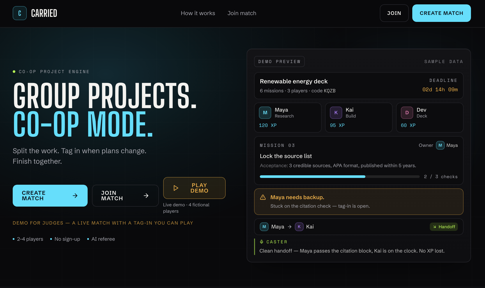
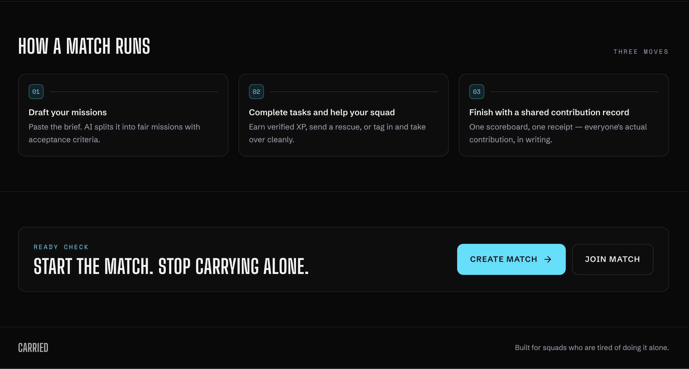

# CARRIED

**GROUP PROJECTS. CO-OP MODE.**
Split the work. Tag in when plans change. Finish together.

**Live app:** https://carried-squad-quest.base44.app

🥉 **3rd place, Base44 Build Night**, San José State University, November 12, 2026. Built by **Lisha Nishat** and **Manank Joshi** (team *Based*) with [Base44](https://base44.com) and its AI-assisted app builder.



---

## The problem

Student group projects tend to break in the same places:

- Nobody is sure who owns what, so work gets duplicated or forgotten.
- Updates and drafts get buried in the group chat.
- When someone gets stuck or runs out of time, whoever picks up their part has to work out where they left off.
- Afterwards, nobody can say what was agreed, submitted and finished.

CARRIED puts responsibilities, "done means" criteria, submitted work, help requests and handoffs in one shared match. The game layer (squads, missions, XP, a commentator) makes keeping it up to date feel less like admin.

It is built for small teams of 2 to 4: class group projects, hackathon teams, any short project with a deadline.

## How a match works

A match moves through four states: `lobby` → `draft` → `live` → `finished`.

1. **Create.** The host enters a display name, project title, brief, deadline and team size (2 to 4) and gets a four-letter join code.
2. **Join.** Teammates join from their own devices with the code (or the `/join?code=XXXX` link or QR code) and a display name. There are no accounts.
3. **Draft.** The host asks the AI to split the brief into one role per player, each with 3 to 5 missions. Every mission has a description, a "done means" line (acceptance criteria), effort points, a difficulty, a target date, and optional dependencies on earlier missions. The host can edit, add and delete missions and roles until the match starts. Players claim roles.
4. **Play.** Players start missions, submit proof, ask for a Rescue or hand off with a Tag-In. Teammates review submissions.
5. **Finish.** The host ends the match. The results screen shows completion, an MVP, a leaderboard, up to three awards and the work left open. A printable contribution receipt records what happened.

There is also a **Play Demo** button that opens a fictional match (players Maya, Kai, Alex and Jordan) with a Tag-In waiting to be accepted.



## Two ways to help: Rescue vs Tag-In

| | **Rescue** | **Tag-In** |
| --- | --- | --- |
| Means | "Help me with this." | "Take over from here." |
| Who owns the mission | The original owner, throughout. | Ownership moves to the teammate who accepts. |
| What the requester writes | The blocker, the help needed, optional links. | What's finished, what remains, where the work is, an optional reason. |
| Flow | Owner asks → mission shows as `blocked` → a teammate volunteers → the owner closes the rescue → mission back to `in_progress`. | Owner asks → mission shows as `tag_in_requested` → a teammate accepts → they become the owner → mission back to `in_progress`. The requester can cancel before anyone accepts. |
| History | The rescue is kept and listed on the receipt. | The previous owner is kept in the mission's `previous_owner_ids` and the handoff is listed on the receipt. |
| Credit | Helper gets **+40 XP** when the mission is later confirmed. The owner keeps the mission's XP. | Original owner gets **+15 XP** for a clean handoff when the Tag-In is accepted. The new owner gets the mission's XP **plus +40 XP** when it is confirmed. |

## Scoring

XP comes from the app's own rules (`src/lib/xp.js`, `src/lib/game-engine.js`):

| Event | XP | Who |
| --- | --- | --- |
| Mission confirmed | the mission's effort points (20–500) | the current owner |
| Rescue assist | +40 | the helper |
| Tag-in assist | +40 | the teammate who tagged in and finished |
| Clean handoff | +15 | the player who handed off |
| Helpful review | +10 | a teammate who reviews someone else's submission |

Each award is written as a `ContributionEvent` with a dedupe key (event, mission, player, and the related request), and the app checks for an existing key before paying, so a repeated approval does not pay twice. XP already earned stays when a mission changes owner.

**XP is not a measure of who worked hardest.** Effort points are the AI's estimate (editable by the host), and only work that was submitted and confirmed in the app counts.

## Evidence and review

- A player submits proof for their own mission: a written explanation, a link, and optionally a file (uploaded to Base44 private storage and opened later through a signed URL).
- An **AI referee** reads the text and returns `CONFIRMED`, `NEEDS_REVISION` or `INSUFFICIENT_EVIDENCE`, with a reason, requirements met and missing, and a confidence score. Its prompt tells it that it cannot open links or attachments, so a link alone only proves something was linked.
- **The AI only recommends.** A teammate makes the call: *confirm* (mission becomes `confirmed` and XP is paid) or *send back* (mission becomes `needs_revision`). In a match with more than one player, you cannot decide on your own submission.
- If the AI call fails, the submission is marked for manual teammate review instead of blocking.

Mission statuses in the code: `available`, `in_progress`, `blocked`, `tag_in_requested`, `under_review`, `confirmed`, `needs_revision`.

## Feature status

Checked against the source in this repository. "Needs Base44" means it relies on the Base44 backend (database, AI or file storage) and could not be exercised in this repo on its own.

| Feature | Status |
| --- | --- |
| Create / join with a 4-letter code and display name, no accounts | Implemented · needs Base44 |
| AI draft of roles and missions with acceptance criteria and effort points | Implemented · needs Base44 AI |
| Host editing of the draft, role claiming | Implemented |
| Evidence submission with text, link and optional private file upload | Implemented · needs Base44 storage |
| AI referee recommendation + teammate decision | Implemented · needs Base44 AI |
| XP scoring with dedupe | Implemented |
| Rescue | Implemented · owner-tested |
| Tag-In | Implemented · owner-tested |
| Mission dependencies ("waiting on…", critical-path-cleared events) | Implemented. Dependencies can only point to earlier missions, so cycles can't form. |
| Team Health (0–100 with reasons) | Implemented — see below |
| Caster commentary | Implemented: one AI-written line per event (all caps, max ~15 words), with a fixed template line for every event type if the AI call fails. The host can turn it off per match. |
| Spoken commentary | Implemented with the browser's `speechSynthesis`; off by default, toggled per device. |
| QR join | Implemented: the QR image comes from the public `api.qrserver.com` service, with a plain link fallback if it can't load. |
| Results screen with MVP, leaderboard and up to 3 awards (pool: MVP, Clutch, Relay Legend, Best Support, Finisher, Unblocker) | Implemented. Award blurbs are AI-written with fixed fallbacks. |
| Contribution receipt | Implemented as a print-friendly page (`/match/CODE/receipt`): use the browser's Print / Save as PDF. No direct download button. |
| Play Demo | Implemented and interactive: you can switch between the four fictional players, accept the Tag-In and submit proof. In the demo, submitting proof auto-confirms and finishes the match. |
| Final Boss Mode | Partial: a banner whose health bar is the unconfirmed work. It shows when the host turns it on or when less than 24 hours remain. It does not change any rules or scoring. |
| Appeals | Not implemented. The only remedy is the teammate review decision. |

**Team Health** starts at 100 and subtracts for open effort (up to 35), overdue missions (6 each, max 20), blocked missions (5 each, max 15), and time left (−25 if the deadline has passed, −12 under 24 hours, −5 under 72 hours). Completion % is separate: confirmed effort points ÷ total effort points.

## Tech stack

From `package.json` and the source:

- **React 19** on **TanStack Start** (file-based routes, server functions, SSR) with **TanStack Router** and **TanStack Query**
- **Tailwind CSS 3** with **shadcn/ui** components on **Radix UI**; **lucide-react** icons; **sonner** toasts; **canvas-confetti** on the results screen
- **zod** for server-function input validation
- **@base44/sdk** (entities, `InvokeLLM`, private file upload, signed URLs) and **@base44/vite-plugin**
- **Vite 8** with the **Cloudflare Vite plugin / Wrangler**: the app builds to a Cloudflare Worker, which is how Base44 hosts it
- Fonts: Big Shoulders Display, Schibsted Grotesk, Space Mono (Google Fonts)

`package.json` also lists packages from the Base44 starter template that Carried doesn't use (for example Stripe, three.js, Leaflet, Recharts). They were left as they are.

## Architecture

```
Browser (React pages + polling)
        │  server functions (TanStack Start)
        ▼
Cloudflare Worker hosted by Base44
  src/lib/match-fns.js    create / join / read state
  src/lib/draft-fns.js    AI draft, edit missions, claim roles, start
  src/lib/mission-fns.js  proof, AI referee, review, rescue, tag-in, end match
  src/lib/demo-fns.js     fictional demo match
  src/lib/game-engine.js  auth, scoring, caster, health, snapshot
        │  @base44/sdk (service role)
        ▼
Base44 backend: entities (base44/entities/*.jsonc), AI (InvokeLLM), private file storage
```

- **Identity.** Joining creates a `Player` and a random participant token. The token is stored in the browser's `localStorage` and in the match's `member_tokens`. Every server function checks the match code **plus** that token. The join code only finds a match; it does not authorize actions. Host-only actions (draft, edit, start, end, caster, Final Boss) also check the host's player ID.
- **Data access.** Entity permissions are admin-only, so the browser never reads the database directly. Server functions act with Base44's service role after the token check.
- **Live updates.** Each device polls the match every 5 seconds (the receipt page every 10). The server returns a cached snapshot stored on the `Match` record (`state_cache`), which is patched or rebuilt after each action. There are no websockets.
- **Data model.** `Match`, `Player`, `Role`, `Objective`, `Dependency`, `Evidence`, `Review`, `RescueRequest`, `TagInRequest`, `ContributionEvent`, `MatchEvent` (schemas in `base44/entities/`). `User` is Base44's built-in entity and is not used for players.

## Running it locally

You need **Node 22** and a **Base44 app** to talk to. The frontend builds on its own, but every match feature calls the Base44 backend, so a standalone build without Base44 credentials loads the pages and fails on any match action.

```bash
npm install --legacy-peer-deps   # see note below
cp .env.example .env             # then fill in your own Base44 app values
npm run dev                      # dev server
npm run build                    # production build (Cloudflare Worker output in dist/)
npm run lint
```

- `--legacy-peer-deps` is needed because the newest releases of `@tanstack/ai` and `@tanstack/ai-openai` disagree on a peer version. Base44 avoids this with its own lockfile; the `package-lock.json` here was regenerated during repo preparation.
- `.env.example` lists the three public client settings the app reads (`VITE_BASE44_APP_ID`, `VITE_BASE44_APP_BASE_URL`, `VITE_BASE44_FUNCTIONS_VERSION`). They are app identifiers, not secrets. No API keys are needed: AI calls go through Base44's built-in integration.
- To run against a backend you would need a Base44 app with the entities in `base44/entities/` and its AI and file-storage integrations. The Base44 CLI (`base44 dev`, `base44 deploy`) is the intended tool. This is **not** a self-hosted app.

## What this repository contains

- The Carried source as it exists in Base44: pages, match components, server functions, game engine, entity schemas, styles and config.
- The source was exported by asking the Base44 builder to print each file, then reassembled. Base44 itself flagged and corrected two copying errors (a version number in `package.json` and one line in `src/lib/ai.server.js`), and those corrections are applied.
- **Only the UI components the app actually imports** from `src/components/ui/` are included (button, command, dialog, image and its helpers, input, input-otp, label, popover, sonner). The other unused shadcn/ui components from the Base44 template were not exported.
- `src/components/auth/` is Base44's auth boilerplate. Carried has no routes that use it, since players join without accounts. `.env.example` was written for this repo because Base44 would not print its own copy.
- Not included: `src/routeTree.gen.ts` (generated on every build) and anything in `.gitignore`.

## Validation

Run during repository preparation (November 13, 2026):

| Check | Result |
| --- | --- |
| `npm install --legacy-peer-deps` | Passed |
| `npm run build` | Passed (with the expected warning that `VITE_BASE44_APP_ID` is not set) |
| `npm run lint` | Passed, no errors |
| Every `@/…` import resolves to a file in the repo | Passed |
| Automated tests | None exist in the project |

**Not tested here:** multiplayer sessions, AI calls, file uploads and anything else that needs the Base44 backend. A passing build does not show those work. The owners report testing the core match flow (create, join, AI missions, review and scoring, results), Rescue and Tag-In on the live app.

## Known limitations

- **Simultaneous Tag-In accepts.** Accepting checks that the Tag-In is still open and then updates it, as two separate steps. Two teammates accepting at the same moment could both pass the check. The XP dedupe check works the same way (check, then write), so very close duplicate requests could in principle double-award.
- **Joining.** Anyone with the code can join while the match is in the lobby or draft, until it is full. Names must be unique within a match.
- **Identity is per device.** Clearing browser storage or switching devices loses your seat; the token isn't recoverable.
- **The AI referee only reads text.** It can't open links or files, and its recommendation is advisory.
- **QR codes use a third-party service** (`api.qrserver.com`), which receives the join URL.
- **Polling, not live push**, so updates can take up to 5 seconds to appear.

## Roadmap

- Appeals for disputed review decisions
- Make Final Boss Mode change something (for example, bonus XP near the deadline)
- One-click PDF / image export of the receipt
- Live updates instead of polling
- Make Tag-In acceptance and XP awards atomic
- Optional accounts so a seat survives a device change

## Credits

Built by **Lisha Nishat** and **Manank Joshi** (team *Based*) at Base44 Build Night, SJSU, using Base44's AI-assisted app builder.

## License

Not yet selected. All rights reserved by the authors until a license is chosen.
